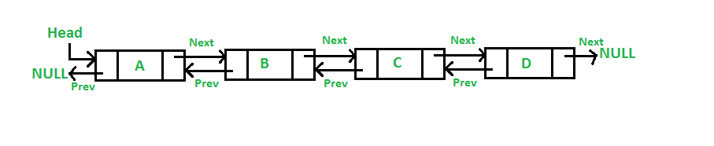

# 🚀 DSA Lab – Class 6 : Doubly Linked List (Scratch Implementation)

🧑‍🏫 **Welcome back, students!**
In today’s lab, we'll take your Linked List knowledge to the next level by building a **Doubly Linked List** **from scratch** — absolutely NO built-in Java collections.

---

# 🎯 Lab Objectives

✅ Understand how **prev** and **next** pointers work
✅ Create a custom **Doubly Linked List (DLL)** class
✅ Implement `addFirst`, `addLast`, `deleteFirst`, `deleteLast`, `printForward`, `printBackward`
✅ Analyze time & space complexities
✅ Solve mini challenges using DLL

---

# 🧩 1. Introduction to Doubly Linked Lists

💡 **Concept**
A **Doubly Linked List** is similar to a singly linked list, BUT each node points **both ways**:

* `next` → points to next node
* `prev` → points to previous node

This enables **bidirectional traversal**.

| Singly Linked List       | Doubly Linked List          |
| ------------------------ | --------------------------- |
| One pointer (next)       | Two pointers (next + prev)  |
| Can move only forward    | Can move forward & backward |
| Less memory              | More memory usage           |
| Hard to delete last node | Easier deletion             |


---

## **2. Why Use a Doubly Linked List?**

| Feature                       | Singly LL | Doubly LL        |
| ----------------------------- | --------- | ---------------- |
| Traverse Backwards            | ❌ No      | ✔ Yes            |
| Delete Without Prev Reference | ❌ Hard    | ✔ Easy           |
| Memory                        | ✔ Less    | ❌ More           |
| Implementation                | Simple    | Slightly complex |

Use DLL when:

* You need **fast insert/delete** at both ends.
* You need **traversal in both directions** (undo/redo, music playlist, browser history).

---


---

## Visualization


---


# ⚙️ 2. Structure of a Node

💡 Each DLL node contains:

* `data`
* `next` pointer
* `prev` pointer

```java
class Node {
    int data;
    Node next;
    Node prev;

    Node(int data) {
        this.data = data;
        this.next = null;
        this.prev = null;
    }
}
```

---

# 🧱 3. Creating a Doubly Linked List Manually

```java
Node head = new Node(10);
Node second = new Node(20);
Node third = new Node(30);

head.next = second;
second.prev = head;

second.next = third;
third.prev = second;
```

📘 **Visualization**

```
null ← [10] ⇆ [20] ⇆ [30] → null
```

---

# 🧩 4. Custom Doubly Linked List Class

Below is your **scratch-built DLL** with all major operations.

---

## 🔹 4.1 `addFirst()` – Insert at Beginning

```java
public void addFirst(int data) {
    Node newNode = new Node(data);

    if (head == null) {
        head = tail = newNode;
        return;
    }

    newNode.next = head;
    head.prev = newNode;
    head = newNode;
}
```

🖥️ Example

```
addFirst(20) → 20  
addFirst(10) → 10 ⇆ 20
```

---

## 🔹 4.2 `addLast()` – Insert at End

```java
public void addLast(int data) {
    Node newNode = new Node(data);

    if (head == null) {
        head = tail = newNode;
        return;
    }

    tail.next = newNode;
    newNode.prev = tail;
    tail = newNode;
}
```

🖥️ Example

```
10 ⇆ 20 ⇆ 30
```

---

## 🔹 4.3 `printForward()` – Traverse Left → Right

```java
public void printForward() {
    Node temp = head;
    System.out.print("Forward: ");
    while (temp != null) {
        System.out.print(temp.data + " ⇆ ");
        temp = temp.next;
    }
    System.out.println("null");
}
```

---

## 🔹 4.4 `printBackward()` – Traverse Right → Left

```java
public void printBackward() {
    Node temp = tail;
    System.out.print("Backward: ");
    while (temp != null) {
        System.out.print(temp.data + " ⇆ ");
        temp = temp.prev;
    }
    System.out.println("null");
}
```

---

## 🔹 4.5 `deleteFirst()` – Remove from Start

```java
public void deleteFirst() {
    if (head == null) {
        System.out.println("Empty List");
        return;
    }
    if (head == tail) {
        head = tail = null;
        return;
    }
    head = head.next;
    head.prev = null;
}
```

---

## 🔹 4.6 `deleteLast()` – Remove from End

```java
public void deleteLast() {
    if (head == null) {
        System.out.println("Empty List");
        return;
    }
    if (head == tail) {
        head = tail = null;
        return;
    }
    tail = tail.prev;
    tail.next = null;
}
```

---

## 🔹 4.7 🎯 Full DLL Class (Complete Implementation)

```java
class DoublyLL {

    Node head, tail;

    class Node {
        int data;
        Node next, prev;

        Node(int data) {
            this.data = data;
        }
    }

    public void addFirst(int data) {
        Node newNode = new Node(data);
        if (head == null) {
            head = tail = newNode;
            return;
        }
        newNode.next = head;
        head.prev = newNode;
        head = newNode;
    }

    public void addLast(int data) {
        Node newNode = new Node(data);
        if (head == null) {
            head = tail = newNode;
            return;
        }
        tail.next = newNode;
        newNode.prev = tail;
        tail = newNode;
    }

    public void printForward() {
        Node temp = head;
        while (temp != null) {
            System.out.print(temp.data + " ⇆ ");
            temp = temp.next;
        }
        System.out.println("null");
    }

    public void printBackward() {
        Node temp = tail;
        while (temp != null) {
            System.out.print(temp.data + " ⇆ ");
            temp = temp.prev;
        }
        System.out.println("null");
    }

    public void deleteFirst() {
        if (head == null) return;
        if (head == tail) {
            head = tail = null;
            return;
        }
        head = head.next;
        head.prev = null;
    }

    public void deleteLast() {
        if (head == null) return;
        if (head == tail) {
            head = tail = null;
            return;
        }
        tail = tail.prev;
        tail.next = null;
    }
}
```

---

# 🖥️ Demo in `main()`

```java
public static void main(String[] args) {
    DoublyLL dll = new DoublyLL();

    dll.addFirst(20);
    dll.addFirst(10);
    dll.addLast(30);

    dll.printForward();
    dll.printBackward();

    dll.deleteFirst();
    dll.printForward();

    dll.deleteLast();
    dll.printForward();
}
```

🖥️ Output

```
Forward: 10 ⇆ 20 ⇆ 30 ⇆ null
Backward: 30 ⇆ 20 ⇆ 10 ⇆ null
Forward: 20 ⇆ 30 ⇆ null
Forward: 20 ⇆ null
```

---

# 📊 Complexity Summary

| Operation     | Time | Space |
| ------------- | ---- | ----- |
| addFirst      | O(1) | O(1)  |
| addLast       | O(1) | O(1)  |
| deleteFirst   | O(1) | O(1)  |
| deleteLast    | O(1) | O(1)  |
| printForward  | O(n) | O(1)  |
| printBackward | O(n) | O(1)  |

---

# 🧠 Practice Zone

1️⃣ Build DLL with elements:
`5 ⇆ 10 ⇆ 15 ⇆ 20 ⇆ 25`

2️⃣ Print list forward & backward

3️⃣ Delete first & last

Expected Output:

```
Forward: 10 ⇆ 15 ⇆ 20 ⇆ null  
Backward: 20 ⇆ 15 ⇆ 10 ⇆ null
```

---

# 🧩 Mini Challenges (Scratch Implementation)

---

💻 Code

```java
 // Delete a node by value
    public void deleteByValue(int value) {
        if (head == null) {
            System.out.println("List is empty.");
            return;
        }

        Node temp = head;

        // Case 1: delete head
        if (temp.data == value) {
            head = head.next;
            if (head != null) head.prev = null;
            System.out.println(value + " deleted.");
            return;
        }

        // Traverse to find node
        while (temp != null && temp.data != value) {
            temp = temp.next;
        }

        if (temp == null) {
            System.out.println("Value not found.");
            return;
        }

        
        // Update tail if last node is being deleted
        if (temp.next == null) {
            tail = temp.prev;
        }


        // Update links
        if (temp.next != null) temp.next.prev = temp.prev;
        if (temp.prev != null) temp.prev.next = temp.next;

        System.out.println(value + " deleted.");
    }

```

```

Delete Node (20)

Before:
[10] ⇄ [20] ⇄ [30]

After deleting 20:
[10] ⇄ [30]

```
---


## ✅ deleteAfterValue(int value)

```java
public void deleteAfterValue(int value) {
    if (head == null) {
        System.out.println("List is empty");
        return;
    }

    Node temp = head;

    // find the node with given value
    while (temp != null && temp.data != value) {
        temp = temp.next;
    }

    if (temp == null) {
        System.out.println("Value not found");
        return;
    }

    // no next node to delete
    if (temp.next == null) {
        System.out.println("No next node exists");
        return;
    }

    System.out.println(temp.next.data + " deleted.");

    // CASE 1: deleting tail
    if (temp.next.next == null) {
        temp.next = null;
        tail = temp;
        return;
    }

    // CASE 2: deleting a middle node
    temp.next = temp.next.next;
    temp.next.prev = temp;
}
```
---

## ✅ deleteBeforeValue(int value)

```java
public void deleteBeforeValue(int value) {
    if (head == null) {
        System.out.println("List is empty");
        return;
    }

    Node temp = head;

    // find the node with given value
    while (temp != null && temp.data != value) {
        temp = temp.next;
    }

    if (temp == null) {
        System.out.println("Value not found");
        return;
    }

    // no previous node to delete
    if (temp.prev == null) {
        System.out.println("No previous node exists");
        return;
    }

    System.out.println(temp.prev.data + " deleted.");

    // CASE 1: deleting head (previous node is head)
    if (temp.prev.prev == null) {
        head = temp;
        temp.prev = null;
        return;
    }

    // CASE 2: deleting a middle node
    temp.prev = temp.prev.prev;
    temp.prev.next = temp;
}
```

---

## 🔁 Symmetry with deleteBefore (great for teaching)

| Operation     | Pointer first | Pointer second |
| ------------- | ------------- | -------------- |
| Delete Before | `prev`        | `next`         |
| Delete After  | `next`        | `prev`         |


---


## 🔹 Challenge 1 – Reverse DLL (Without Creating New List)

💻 Code

```java
public void reverseDLL() {
    Node current = head;
    Node temp = null;

    while (current != null) {
        temp = current.prev;
        current.prev = current.next;
        current.next = temp;
        current = current.prev;
    }

    if (temp != null)
        head = temp.prev;
}
```

---

## 🔹 Challenge 2 – Search Element in DLL

```java
public int search(int key) {
    Node temp = head;
    int index = 0;

    while (temp != null) {
        if (temp.data == key) return index;
        temp = temp.next;
        index++;
    }
    return -1;
}
```

---

# 🎓 Wrap-Up

✔ Built fully custom **Doubly Linked List**
✔ Covered forward/backward traversal
✔ Implemented insertion & deletion
✔ Added searching & reversing mini challenges
